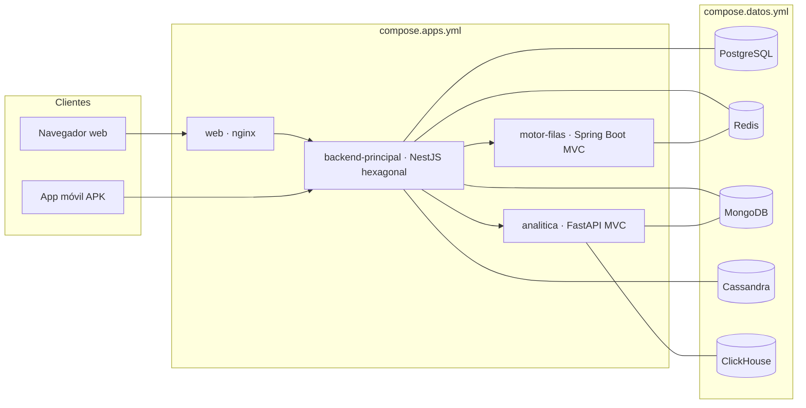

# COOTEP Turno

Prototipo académico de filas virtuales para 8 agencias simuladas de COOTEP
(Programación Avanzada – Bases de Datos No Relacionales, Uniputumayo, 2026-2).

Este es el repositorio **paraguas** de la entrega: contiene la infraestructura Docker,
la documentación y, como submódulos, los cinco repositorios de código. Su etiqueta
(`v1.0.0`, por ejemplo) fija el commit exacto de cada submódulo, así que es el único
enlace y el único identificador que se entrega en Moodle.

## Repositorios de la organización

Organización: <https://github.com/COOTEP-GESTOR-TURNOS>

| Repositorio | Tecnología | Arquitectura | Submódulo en |
| --- | --- | --- | --- |
| `backend-principal` | TypeScript · NestJS 11 · Node.js 22 | Hexagonal | `apps/backend-principal` |
| `backend-motor-filas` | Java 21 · Spring Boot 3.5 | MVC | `apps/motor-filas` |
| `cootep-fastAPI` | Python 3.12 · FastAPI | MVC | `apps/analitica` |
| `frontend` | React 19 · Vite 6 · nginx | Componentes por rol | `apps/web` |
| `mobile` | React Native · Expo SDK 58 (APK) | Pantallas por rol | `apps/movil` |
| `cootep-turno` (este) | Docker Compose, scripts, documentación | — | — |

## Arquitectura



Solo el backend principal recibe a los clientes. El motor de filas y la analítica no
publican puertos: se alcanzan únicamente dentro de la red externa `cootep-net`.

## Puesta en marcha

Requisitos: Docker Desktop con Compose v2, Git y unos 8 GB de RAM libres.

```bash
git clone --recurse-submodules https://github.com/COOTEP-GESTOR-TURNOS/cootep-turno.git
cd cootep-turno
cp infra/.env.example infra/.env        # y cambie TODAS las contraseñas
docker network create cootep-net
docker compose -f infra/compose.datos.yml up -d --wait
docker compose -f infra/compose.apps.yml up -d --build --wait
docker compose -f infra/compose.apps.yml exec backend-principal node dist/cli/crear-superadmin.js
```

Si Docker responde `ports are not available ... forbidden by its access permissions`, Windows
reservó ese puerto (pasa con 8080 y 8025 después de algunos reinicios). Hay dos salidas:

- Liberarlo: en una terminal de administrador, `net stop winnat` y luego `net start winnat`.
- Usar otro puerto: `PUERTO_WEB`, `PUERTO_CORREO` y `PUERTO_BACKEND` en `infra/.env`. Si cambia el de
  la web, ajuste `URL_PUBLICA` y agregue el nuevo URI de redireccionamiento en Google.

El orden importa: primero la red, luego los datos (el `--wait` espera sus healthchecks;
Cassandra tarda 1 a 2 minutos) y al final las aplicaciones.

| Servicio | URL en el equipo |
| --- | --- |
| Web | <http://localhost:8080> |
| API del backend principal | <http://localhost:3000/api/v1> |
| OpenAPI del backend principal | <http://localhost:3000/api/docs> |
| Buzón de correo de pruebas (Mailpit) | <http://localhost:8025> |

### Primer ingreso y cuentas

1. Ingrese en la web con `SUPERADMIN_EMAIL` y `SUPERADMIN_PASSWORD_TEMPORAL`. El sistema pide
   cambiar la clave y activar la verificación en dos pasos (escanee el QR con Google Authenticator).
2. En **Administración**, cree el directivo de cada agencia (rol administrador de agencia). Le llega
   un correo (en Mailpit) para definir su clave; en su primer ingreso también activa MFA.
3. El directivo da de alta a los funcionarios de su agencia y les asigna su servicio.
4. Los asociados se registran solos en **Crea tu cuenta** o entran con Google.

Los correos de activación, confirmación y recuperación llegan a Mailpit. Para enviarlos de verdad
(por ejemplo con Gmail y una contraseña de aplicación) cambie `SMTP_*` en `infra/.env`.

### Migraciones de PostgreSQL

Los scripts de `infra/init/postgres` corren solos cuando el volumen está vacío. Si su volumen ya
existía, aplique los nuevos a mano (son idempotentes). En Git Bash anteponga `MSYS_NO_PATHCONV=1`:

```bash
MSYS_NO_PATHCONV=1 docker compose -f infra/compose.datos.yml exec -T postgres psql -U cootep -d cootep -f /docker-entrypoint-initdb.d/03-identidad.sql
MSYS_NO_PATHCONV=1 docker compose -f infra/compose.datos.yml exec -T postgres psql -U cootep -d cootep -f /docker-entrypoint-initdb.d/04-administracion.sql
```

Si clonó los repositorios como carpetas hermanas (sin submódulos), ajuste las variables
`RUTA_*` de `infra/.env` (por ejemplo `RUTA_BACKEND_PRINCIPAL=../../backend-principal`).

### Índices y columnas de la analítica

Al arrancar, la analítica crea los índices de MongoDB y la columna `colaborador_id` de ClickHouse,
también en volúmenes ya inicializados; no hay que ejecutar nada a mano. En una instalación que ya
tenía indicadores cargados, los turnos anteriores quedan sin responsable hasta una recarga completa:

```powershell
docker compose --env-file infra/.env -f infra/compose.apps.yml exec -T analitica python -m app.scripts.reproyectar_indicadores
```

### APK

La app móvil se compila fuera de Docker. En `movil/.env` ponga la IP del computador en la
red local (`EXPO_PUBLIC_API_URL=http://192.168.x.x:3000`), nunca `localhost`. Los pasos
están en el README del repositorio `movil`.

## Datos de prueba

- `infra/init/postgres/02-datos-prueba.sql`: 8 agencias, 4 servicios, ventanillas y parámetros.

Todos los datos son ficticios. No suba datos personales reales.

Con los contenedores actualizados y en ejecución, use PowerShell desde la carpeta `cootep-turno`.
El comando carga cuentas, turnos con sus eventos de atención y los eventos del calendario de cada
agencia (pagos de subsidio y de nómina, festivos locales) a partir de un solo historial simulado.

```powershell
.\scripts\demo.ps1 generar
```

Los datos simulados van a las mismas tablas y colecciones que los reales, marcados con
`origen: "SIMULADO"`, y pasan por el mismo ETL hacia ClickHouse: la demostración recorre el camino
que usaría el banco. En **Indicadores** aparece el aviso "Datos simulados" en las agencias que los
tienen. Si el proyecto pasa a producción, no se ejecuta el generador (se niega a correr fuera de
desarrollo) y los datos reales se acumulan día a día; el pronóstico aparece con 60 días de historia.

La carga genera 540 días por agencia con semilla 7. Use `-Dias` para extender el historial y `-Semilla`
para configurar la primera carga. Puede repetir el mismo comando si se interrumpe. Los días cerrados
se muestran con cero solicitudes. Durante una jornada abierta, se crean tres pendientes por agencia.

En horario de atención, puede preparar otro lote para el panel del funcionario.

```powershell
.\scripts\demo.ps1 pendientes -Lote segunda-ronda
```

Las cuentas se crean con correos ficticios. Para usar una cuenta, asígnele un correo de acceso y
complete la recuperación de contraseña desde la pantalla de ingreso.

```powershell
.\scripts\demo.ps1 activar-usuario -Id <UUID-o-correo-ficticio> -Correo <correo-de-acceso>
```

Para borrar toda la demostración (cuentas, turnos, eventos simulados y el historial del generador
anterior) y reconstruir ClickHouse solo con los datos reales:

```powershell
.\scripts\demo.ps1 limpiar
```

## Respaldo y recuperación de volúmenes

Los comandos se ejecutan con `docker compose -f infra/compose.datos.yml exec <servicio> ...`.

| Motor | Respaldo | Recuperación |
| --- | --- | --- |
| PostgreSQL | `pg_dump -Fc -U cootep cootep > /tmp/cootep.dump` | `pg_restore -U cootep -d cootep --clean /tmp/cootep.dump` |
| MongoDB | `mongodump -u root -p <clave> --authenticationDatabase admin --db cootep --archive=/tmp/cootep.archive` | `mongorestore ... --archive=/tmp/cootep.archive --drop` |
| Redis | Archivo AOF en el volumen `redis_datos` | El backend principal reconstruye las filas desde PostgreSQL |
| Cassandra | `nodetool snapshot cootep` | Copiar las SSTables de la instantánea y cargarlas con `nodetool import` |
| ClickHouse | No hace falta: es derivado | `POST /api/v1/etl/ejecutar?completa=true` en la analítica |

`docker compose down` conserva los volúmenes; `docker compose down -v` los borra.

## Trabajo en equipo con ramas

`main` siempre debe compilar y pasar las pruebas: nadie trabaja directo sobre ella. Cada
funcionalidad va en su rama, con el **mismo nombre en todos los repositorios que toca**, y entra a
`main` con un pull request que revisa otro integrante.

| Rama | Contenido | Repositorios |
| --- | --- | --- |
| `feature/identidad` | Inicio local y con Google, MFA, registro, recuperación por correo, administración de usuarios y roles | backend-principal, frontend, mobile, cootep-turno |
| `feature/administracion-agencias` | Servicios, ventanillas, horario y parámetros por agencia; auditoría para el superadministrador | backend-principal, frontend, mobile |
| `feature/turnos-catalogo` | Catálogo real (`GET /agencias`) en los paneles de turno; cierre de agencia y vencimientos | backend-principal, backend-motor-filas, frontend, mobile |
| `feature/analitica-tablero` | Indicadores y franjas recomendadas en la web y el móvil | cootep-fastAPI, frontend, mobile |

```bash
git switch main && git pull
git switch -c feature/<nombre>          # en cada repositorio que vaya a tocar
git push -u origin feature/<nombre>
```

Mensajes de commit en español y en presente («Agrega…», «Corrige…»). Cuando las ramas de una
funcionalidad se fusionan en `main`, se actualizan los submódulos de este repositorio.

## Trabajo con submódulos

```bash
git submodule update --remote --merge   # trae lo último de cada repositorio
git add apps && git commit -m "Actualiza submódulos"
git tag v1.0.0 && git push --follow-tags
```

Scripts de ayuda (desde Git Bash):

- `./scripts/publicar-en-github.sh`: sube cada carpeta a su repositorio de la organización.
- `./scripts/agregar-submodulos.sh`: agrega los cinco repositorios en `apps/`.
- `python scripts/empaquetar_entrega.py <url-de-este-repo> v1.0.0`: arma el ZIP para Moodle con el
  contenido de los submódulos (la descarga ZIP de GitHub no los incluye).

## Documentación

El informe (PDF y editable), los diagramas fuente y los contratos OpenAPI van en `docs/`.
